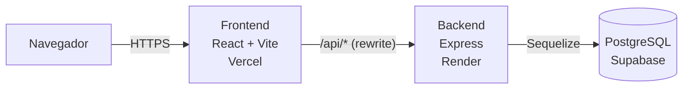
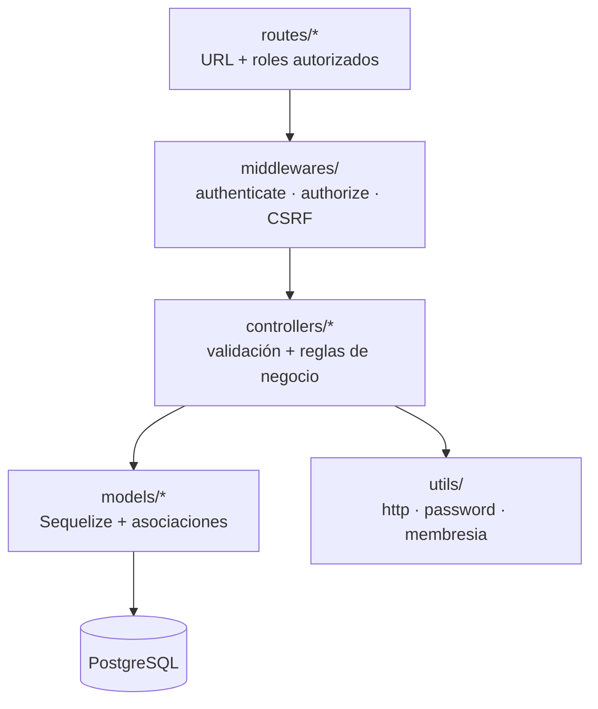
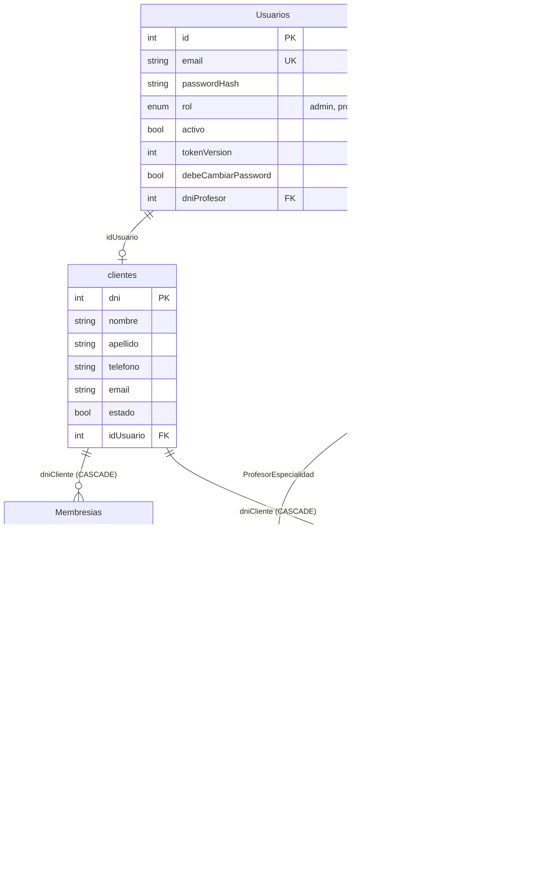
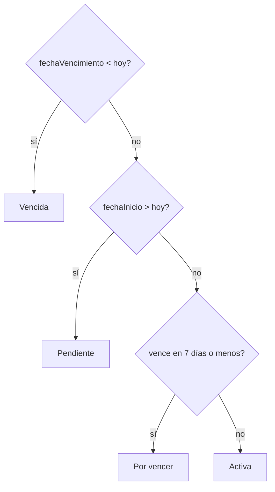

# Arquitectura

## Visión general

El navegador **solo habla con el origen del frontend**. Las llamadas a `/api` las reenvía Vite en desarrollo y Vercel en producción (`vercel.json`) al backend. Por eso la cookie de sesión es "del mismo sitio" y no la bloquean los navegadores.

## Capas del backend

| Capa | Carpeta | Responsabilidad |
|:-|:-|:-|
| Rutas | `backend/src/routes` | Mapea URL y método a un controlador y define qué roles pueden usarla |
| Middlewares | `backend/src/middlewares` | `authenticate` (valida el JWT y vuelve a consultar al usuario), `authorize(...roles)`, chequeo de origen (CSRF) |
| Controladores | `backend/src/controllers` | Validan la entrada, aplican las reglas y arman la respuesta |
| Modelos | `backend/src/models` | Definición de tablas y relaciones (`associations.js`) |
| Utilidades | `backend/src/utils` | Funciones puras reutilizables: validaciones, hash de contraseñas, cálculo del estado de membresía |
| Configuración | `backend/src/config` | Base de datos, autenticación, migrador |
| Migraciones | `backend/migrations` | Historial versionado del esquema |

## Estructura del frontend

| Carpeta | Contenido |
|:-|:-|
| `src/pages` | Una carpeta por pantalla (`Clientes`, `Membresias`, `Rutinas`, `Cliente/MiMembresia`, …) |
| `src/components` | Componentes por dominio (`cliente`, `membresia`, `rutina`, `auth`, `layout`, `ui`) |
| `src/services` | Una función por endpoint (axios con `withCredentials`) |
| `src/models` | Tipos TypeScript de lo que devuelve la API |
| `src/context` + `src/hooks` | Sesión (`AuthProvider`, `useAuth`) y carga de datos (`useAsyncData`) |
| `src/routes` | Rutas por rol, protegidas con `ProtectedRoute` |
| `src/utils` | Formato de fechas/importes, navegación por rol, etc. |

## Modelo de datos

### Reglas de borrado

| Al borrar… | Pasa con… |
|:-|:-|
| un **cliente** | se borran sus membresías, sus rutinas (con sus ejercicios) y su cuenta. El frontend pide confirmación antes |
| un **profesor** sin rutinas | se borra con su cuenta |
| un **profesor con rutinas** | se rechaza con `409`: las rutinas también son del cliente |
| una **rutina** | se borran sus ejercicios |

### Lo que no se guarda: el estado de la membresía

El estado (`Pendiente`, `Activa`, `Por vencer`, `Vencida`) se **calcula** al responder a partir de `fechaInicio` y `fechaVencimiento` y de la fecha de hoy en Argentina. Así nunca queda desactualizado y no hace falta un proceso que lo actualice.

### Clases y turnos (en desarrollo)

Las tablas de clases las está desarrollando otro integrante en su rama: `TiposClase`, `Turnos`, `TurnoProfesores` e `InscripcionTurno`. Cuando se integren se agregan a este diagrama. Ver [migraciones](migraciones.md#ramas-que-agregan-tablas).
