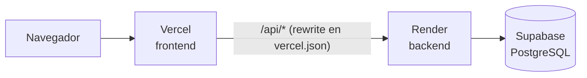

# Deploy

| Parte | Plataforma | Qué se despliega |
|:-|:-|:-|
| Base de datos | [Supabase](https://supabase.com) (PostgreSQL) | La base compartida |
| Backend | [Render](https://render.com) | Rama `main` del repo del backend |
| Frontend | [Vercel](https://vercel.com) | Rama `main` del repo del frontend |

El backend aplica las migraciones pendientes **al arrancar**, así que un deploy nuevo deja la base al día solo.

## Variables de entorno

**Render (backend)**

| Variable | Valor |
|:-|:-|
| `DATABASE_URL` | Connection string de Supabase |
| `NODE_ENV` | `production` |
| `JWT_SECRET` | Uno nuevo, distinto del de desarrollo (mínimo 32 caracteres) |
| `FRONTEND_ORIGIN` | La URL del frontend en Vercel, ej. `https://mi-app.vercel.app` |
| `COOKIE_SAMESITE` | `lax` |
| `TRUST_PROXY` | Cantidad de proxies delante del server. Hay dos (Vercel y Render), así que probablemente `2`. Si queda mal, el límite de intentos de login se aplica a todos los usuarios juntos |

**Vercel (frontend)**

| Variable | Valor |
|:-|:-|
| `VITE_API_URL` | `/api` |

El destino del backend está en el `vercel.json` del frontend (`rewrites`).

## Cuentas de demostración

Para que los evaluadores puedan usar la app desplegada hay tres cuentas, una por rol:

| Rol | Qué puede ver | Cómo se creó |
|:-|:-|:-|
| Administrador | Todo el sistema | `pnpm run create-admin` (o desde Usuarios, con otra cuenta admin) |
| Profesor | Clientes, rutinas propias, su perfil | Desde la pantalla **Profesores** del admin |
| Cliente | Su membresía, sus rutinas, su perfil | Desde la pantalla **Clientes** del admin |

**Las contraseñas no se guardan en el repositorio.** Se entregan por el formulario de entrega de la cátedra. Si hay que rehacer una cuenta, el admin la crea desde la app y le asigna una contraseña conocida (editar → contraseña).

Para que la demostración sea completa, conviene que el cliente de demo tenga una membresía vigente y una rutina asignada por el profesor de demo.

## Checklist ante un problema en el deploy

1. **El login no funciona o la sesión se pierde:** `FRONTEND_ORIGIN` en Render tiene que ser exactamente la URL de Vercel (sin barra final) y el `vercel.json` tiene que apuntar al backend correcto.
2. **Error de conexión a la base:** el proyecto de Supabase gratuito se pausa por inactividad; hay que reanudarlo desde su panel.
3. **No se aplican cambios:** verificar que Render y Vercel estén mirando la rama `main` del repositorio correcto.
4. **Los intentos de login se bloquean para todos:** revisar `TRUST_PROXY`.
