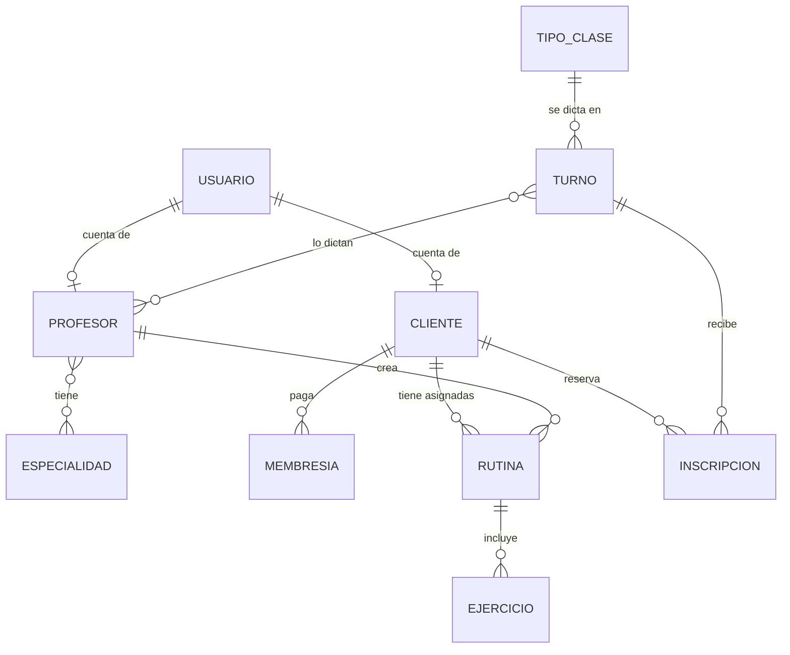

# Propuesta TP DSW

## Grupo
### Integrantes
* 50390 - Cabardos, Matias  
  52331 - Degiovanni, Bianca  
  52199 - Kasperczak, Ian  

### Repositorios
* [frontend app](https://github.com/IanKasperczak/Trabajo-Desarrollo-Frontend)
* [backend app](https://github.com/Campesianoo/Trabajo-Desarrollo)

## Tema
### Descripción
El gimnasio Power Trainer nos convocó para realizar un sistema que permita administrar el flujo de personas en el mismo.
Diariamente los clientes ingresan a la aplicación para reservar un turno y realizar actividades dentro del gimnasio. A lo largo del día los profesores dictan distintas clases, que el gimnasio define a su gusto (por ejemplo musculación, crossfit o funcional). Cada clase tiene una cantidad de cupos limitados para un determinado día y horario, es por ello que los clientes deberán anotarse con anticipación.
El gimnasio también administra las membresías de sus clientes y las rutinas que los profesores les asignan. Cada cliente y cada profesor entra con su propia cuenta, que crea el administrador.

### Modelo

## Alcance Funcional

### Alcance Mínimo

Regularidad:
|Req|Detalle|
|:-|:-|
|CRUD simple|1. CRUD Cliente 2. CRUD Profesor 3. CRUD Especialidad 4. CRUD Tipo de Clase|
|CRUD dependiente|1. CRUD Turno {depende de} CRUD Tipo de Clase y CRUD Profesor 2. CRUD Membresía {depende de} CRUD Cliente 3. CRUD Rutina {depende de} CRUD Cliente y CRUD Profesor|
|Listado + detalle|1. Listado de clientes, muestra nombre, DNI y el estado de la membresía (activa, por vencer, vencida o sin membresía) => detalle muestra los datos del cliente y su rutina asignada 2. Listado de clases del día filtrado por fecha, muestra clase, horario, profesores y lugares ocupados => detalle muestra los clientes anotados en la clase|
|CUU/Epic|1. Reservar un turno para realizar una actividad en un determinado día y horario (con una membresía vigente que cubra el día del turno, al menos 8 horas de anticipación, un turno por día y mientras haya cupo) 2. Registrar la asistencia del cliente a la clase|

La data registrada por el CUU 1 sirve como input para el CUU 2.

Adicionales para Aprobación
|Req|Detalle|
|:-|:-|
|CRUD|1. CRUD Cliente 2. CRUD Profesor 3. CRUD Especialidad 4. CRUD Tipo de Clase 5. CRUD Turno 6. CRUD Membresía 7. CRUD Rutina 8. CRUD Usuario (cuentas y roles)|
|CUU/Epic|1. Reservar un turno para realizar una actividad en un determinado día y horario 2. Registrar la asistencia del cliente a la clase 3. Cancelar una reserva (el cliente libera su lugar)|

### Alcance Adicional Voluntario

|Req|Detalle|
|:-|:-|
|Listados|1. Membresías filtradas por estado y por cliente, con aviso de las que están por vencer 2. Reservas del cliente: próximas clases e historial con su asistencia|
|CUU/Epic|1. Turnos que se repiten todos los días (el sistema genera los de los próximos 30 días)|
|Otros|1. Login con roles (administrador, profesor y cliente) y rutas protegidas según el rol 2. Avisos para el administrador: membresías por vencer y clientes sin membresía vigente o sin rutina 3. Modo claro y oscuro|
